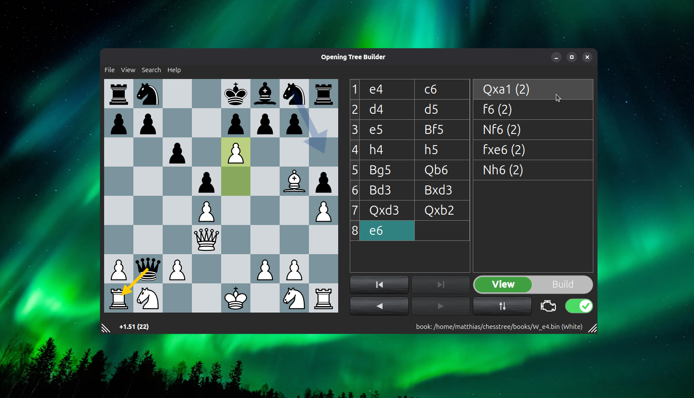

# Opening Tree Builder (OTB)




## What is it?

**OTB** stands for "**O**pening **T**ree **B**uilder". I know this acronym is occupied, it's a tribute to "Over The Board" chess &#128521;

OTB lets you build and save your opening repertoire to a single polyglot file.    
The polyglot format has many advantages over PGN: interchangeability with other tools like SCID, easy detection of transpositions, weigthing of branches and many more:  
https://chessprogramming.org/PolyGlot

OTB offers a $\color{#00FF00}{\text{view-mode (green switch)}}$, where moves that you enter in the chessboard are **NOT** saved.   
In $\color{#FF0000}{\text{build-mode (red board)}}$ every move you enter is immediately saved to the polyglot file without additional user interaction.   
The default-filename name is book.bin, but you can create your own files via <kbd>File</kbd> &rarr; <kbd>New Book...</kbd>   
The currently used book and further status information is displayed in the bottom statusbar.

**<ins>Book color</ins>**: a repertoire is normally built for one side. When you create a book you choose **White**, **Black** or **Both**.   
The color is stored inside the book file and shown in the file name (`W_`, `B_` or `WB_`) and in the statusbar; the board turns to that side when the book is opened.   
For an existing book OTB asks for the color when you open it; change it any time via <kbd>File</kbd> &rarr; <kbd>Book Color...</kbd>

You can also expand your opening tree by importing PGN-files via <kbd>File</kbd> &rarr;   <kbd>Import PGN...</kbd> (e.g. PGN's that you exported from other tools).   
Before the import you can tick one or more players and choose a color: then only the games they played as White, as Black or with both colors are imported.   
If that color does not fit the book, OTB offers to create a new book for it.

**<ins>Deletion</ins>** is done via right-click on a move in build-mode.   
CAUTION: all attached branches to follow behind that node will also be deleted, except positions that can still be reached by another move order.   
Right-click also lets you edit a move's weight (how often it is chosen by engines/GUIs using the book).   

**<ins>Transpositions</ins>** are chess positions, that can be reached by different move orders.\
The predecessor-moves to a transposition are marked in red in the bookmove-list.\   
Right-click transpositions to see all move orders leading there.\
Left-click a line or use the cursor up/down keys to load it to the editor, right-click to copy it as PGN.

**<ins>Play from here</ins>**: right-click a move in the current line to play the line automatically from that move to its end. Any click or key stops it.

**<ins>View menu</ins>**: sets the play speed, the speed of the piece animation and the board coordinates (inside the squares, outside or off).

## Install OTB

### Windows
**[⬇ Download the installer (OTB-Setup.exe)](https://github.com/malo1972/otb/releases/latest/download/OTB-Setup.exe)**

Run the downloaded file and follow the installer — no Python or admin rights needed. It adds OTB to the Start menu (and, if you like, to the desktop).   
To update, just run the new installer: it replaces the old version and keeps your books and settings.   
Windows may show *"Windows protected your PC"*: click **More info** &rarr; **Run anyway**.

---

### Mac / Linux
OTB runs directly from source, managed by [`uv`](https://docs.astral.sh/uv/):

**1.** **[⬇ Download OTB (zip)](https://github.com/malo1972/otb/archive/refs/heads/main.zip)** and unzip it into a folder of your choice.

**2.** Install `uv` (one-time setup) in your terminal:
```
curl -LsSf https://astral.sh/uv/install.sh | sh
```

**3.** Open a terminal in the OTB folder and run:
```
uv run otb.py
```

*(This automatically downloads Python if needed, creates a virtual environment, installs PyQt6 and python-chess, and launches the app.)*

---

### Use an Engine

If you want to use engine-evaluation, toggle the engine-switch.     
A blue arrow will indicate the engine's top choice, the current engine-evaluation is shown leftmost in the statusbar. 
Download your preferred engine (e.g. from https://stockfishchess.org/).    
Then set the location of the engine's executable via <kbd>File</kbd> &rarr; <kbd>Select Engine...</kbd> (will be saved to settings).


## Features to wish for
* Add comments to moves
* You name it. please let me know features that you would like to see implemented
