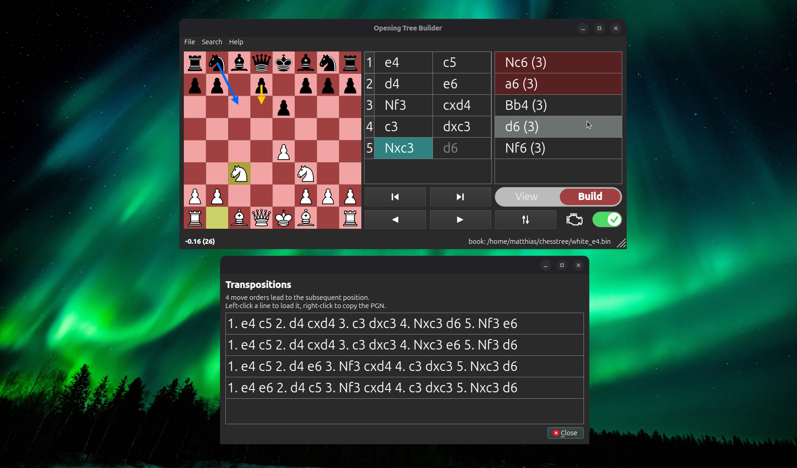

# Opening Tree Builder (OTB)




## What is it?

**OTB** stands for "**O**pening **T**ree **B**uilder". I know this acronym is occupied, it's a tribute to "Over The Board" chess &#128521;

OTB lets you build and save your opening repertoire to a single polyglot file.    
The polyglot format has many advantages over PGN: interchangeability with other tools like SCID, easy detection of transpositions, weigthing of branches and many more:  
https://chessprogramming.org/PolyGlot

OTB offers a $\color{#00FF00}{\text{view-mode (green)}}$, where moves that you enter in the chessboard are **NOT** saved.   
In $\color{#FF0000}{\text{build-mode (red)}}$ every move you enter is immediately saved to the polyglot file without additional user interaction.   
The default-filename name is book.bin, but you can create your own files.   
The currently used book and further status information is displayed in the bottom statusbar.

You can also expand your opening tree by importing PGN-files via <kbd>File</kbd> &rarr;   <kbd>Import PGN...</kbd> (e.g. PGN's that you exported from other tools).

**<ins>Deletion</ins>** is done via right-click on a move in build-mode.   
CAUTION: all attached branches to follow behind that node will also be deleted.   
Right-click also lets you edit a move's weight (how often it is chosen by engines/GUIs using the book).   

**<ins>Transpositions</ins>** are chess positions, that can be reached by different move orders.\
The predecessor-moves to a transposition are marked in red in the bookmove-list.\   
Right-click transpositions to see all move orders leading there.\
Left-click a line to load it to the editor, right-click to copy it as PGN.

## Install OTB

### Windows
**[⬇ Download the installer (OTB-Setup-1.0.exe)](https://github.com/malo1972/otb/releases/download/v1.0/OTB-Setup-1.0.exe)**

Run the downloaded file and follow the installer — no Python or admin rights needed. It adds OTB to the Start menu (and, if you like, to the desktop).   
Windows may show *"Windows protected your PC"*: click **More info** &rarr; **Run anyway**.

---

### Mac / Linux
OTB runs directly from source, managed by [`uv`](https://docs.astral.sh/uv/):

**1.** **[⬇ Download OTB (zip)](https://github.com/malo1972/otb/archive/refs/heads/main.zip)** and unzip it into a folder of your choice.

**2.** Install `uv` (one-time setup) in your terminal:
```
curl -LsSf https://astral.sh/uv/install.sh | sh
```

**3.** Open a terminal in the OTB folder and run:
```
uv run otb.py
```

*(This automatically downloads Python if needed, creates a virtual environment, installs PyQt6 and python-chess, and launches the app.)*

---

### Use an Engine

If you want to use engine-evaluation, toggle the engine-switch.     
A blue arrow will indicate the engine's top choice, the current engine-evaluation is shown leftmost in the statusbar. 
Download your preferred engine (e.g. from https://stockfishchess.org/).    
Then set the location of the engine's executable via <kbd>File</kbd> &rarr; <kbd>Select Engine...</kbd> (will be saved to settings).


## Features to wish for
* Add comments to moves
* You name it. please let me know features that you would like to see implemented
